# PDSwarm UI Tour & Screenshots

A visual walkthrough of the PDSwarm interface — built with Svelte 5 and styled with the Neo-Obsidian aesthetic (`#0a0b10` dark canvas, violet/cyan accents, and glassmorphic surfaces).

---

## Table of Contents

- [Host Telemetry & Dashboard](#host-telemetry--dashboard)
- [Container Management](#container-management)
- [Docker Compose Stacks](#docker-compose-stacks)
- [1-Click App Store](#1-click-app-store)
- [Docker Images & Studio](#docker-images--studio)
- [Persistent Storage Volumes](#persistent-storage-volumes)
- [Network Topologies](#network-topologies)
- [Settings & Administration](#settings--administration)
  - [General Preferences & Host Telemetry](#general-preferences--host-telemetry)
  - [User Accounts & Passwords](#user-accounts--passwords)
  - [Programmatic API Access Tokens](#programmatic-api-access-tokens)
  - [Private Registries](#private-registries)
  - [Template Catalogs](#template-catalogs)

---

### Host Telemetry & Dashboard

Real-time telemetry, host specifications, active background operations feed, quick metrics, and container overview.

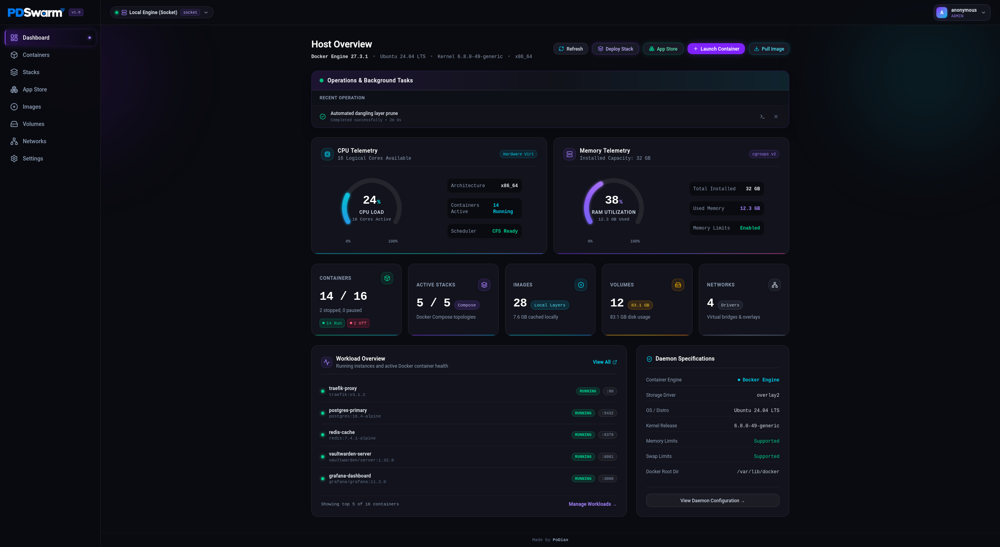

---

### Container Management

Comprehensive container listing with live status indicators, mapped port bindings, health checks, batch actions, and quick controls (Start, Stop, Restart, Duplicate/Edit, Logs, Terminal, File Browser).

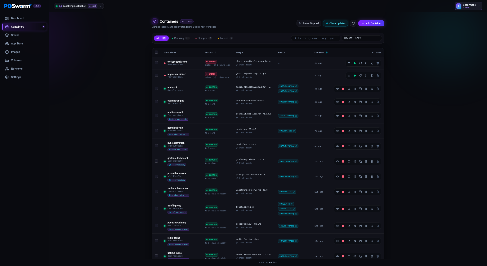

---

### Docker Compose Stacks

Orchestrate, inspect, and manage multi-container application stacks with automated variable interpolation (`${VAR:-default}`) and Compose editor.

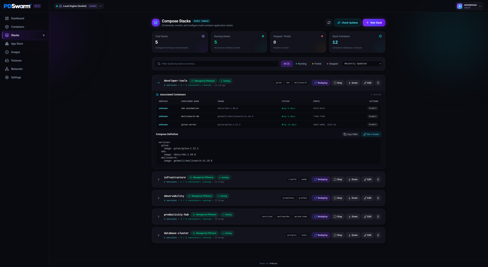

---

### 1-Click App Store

Over 35+ curated, production-grade self-hosted application templates (PostgreSQL, Redis, Traefik, Nextcloud, Jellyfin, Uptime Kuma, Vaultwarden, etc.) ready to deploy in seconds.

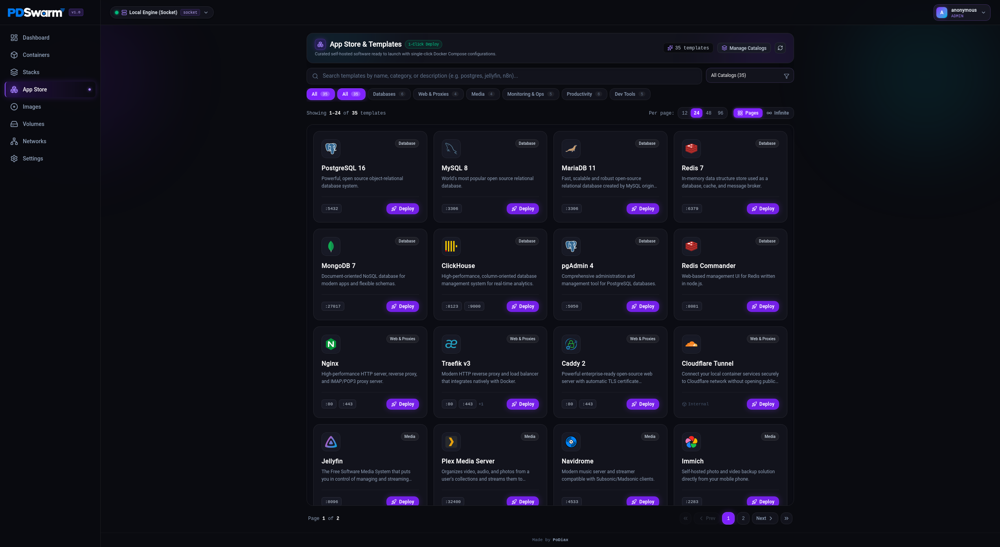

---

### Docker Images & Studio

Inspect local images, view sizes and layer counts, pull from registries, prune untagged layers, and build images directly from the browser with live build streams.

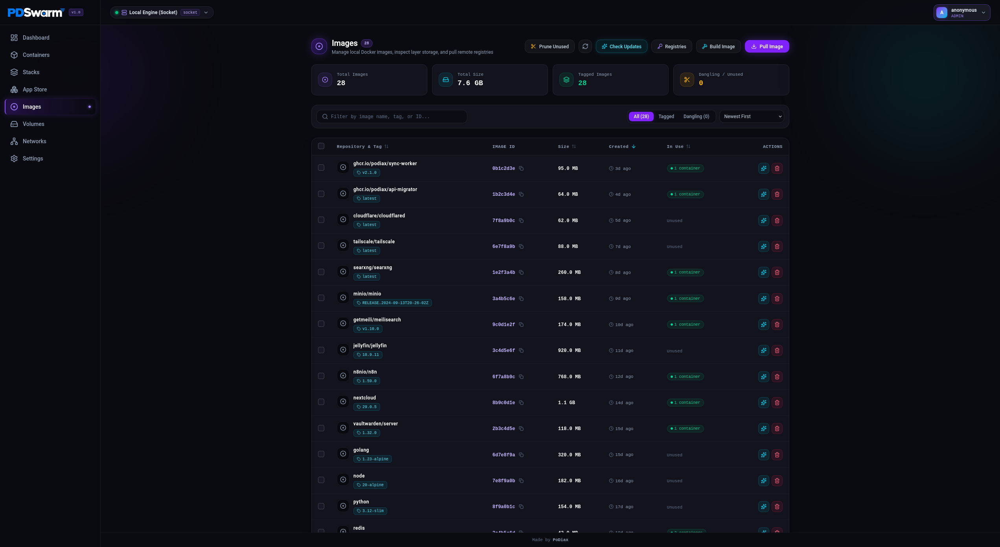

---

### Persistent Storage Volumes

Monitor storage utilization, inspect volume mountpoints, check driver types, and manage persistent data volumes.

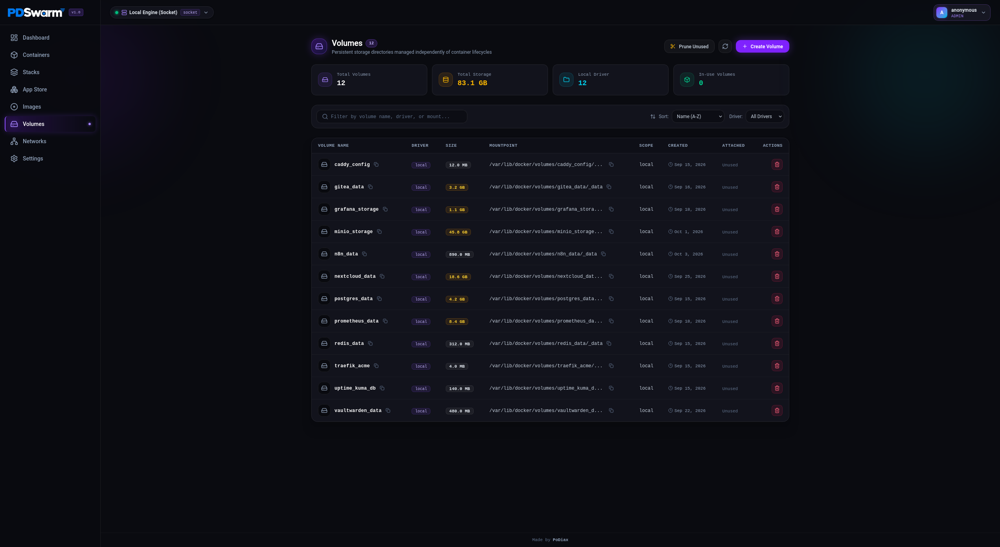

---

### Network Topologies

Inspect Docker virtual bridges, host interfaces, overlay networks, subnets, and container inter-communication topologies.

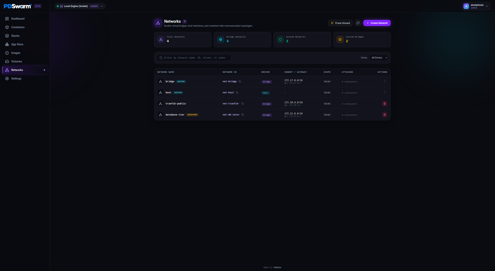

---

### Settings & Administration

#### General Preferences & Host Telemetry

Configure UI refresh rate, default terminal shell preset (`/bin/sh`, `/bin/bash`, `/bin/zsh`, `sh`, `bash`), and inspect host specs.

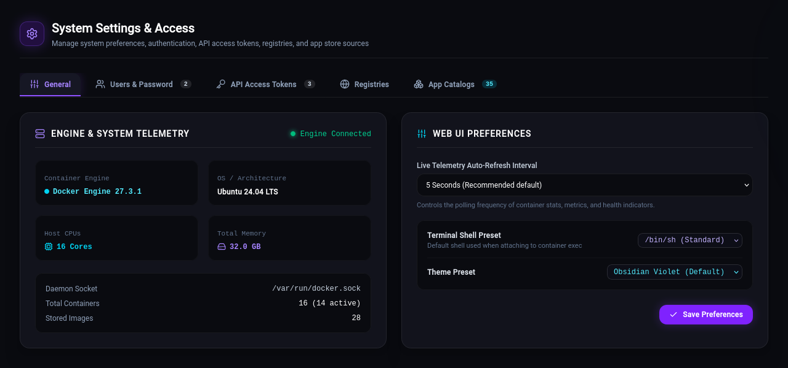

#### User Accounts & Passwords

Multi-user management with role-based access control (Admin, Operator) and secure bcrypt password updates.

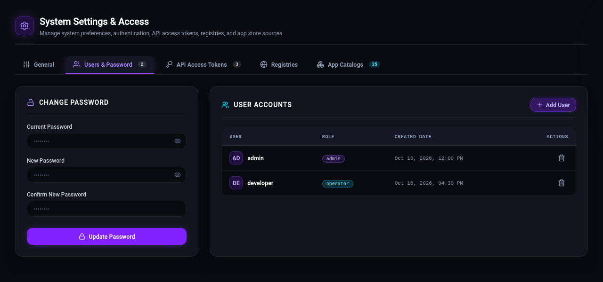

#### Programmatic API Access Tokens

Create, inspect, and revoke scoped `pds_...` access tokens for automation scripts, CI/CD pipelines, and webhooks.

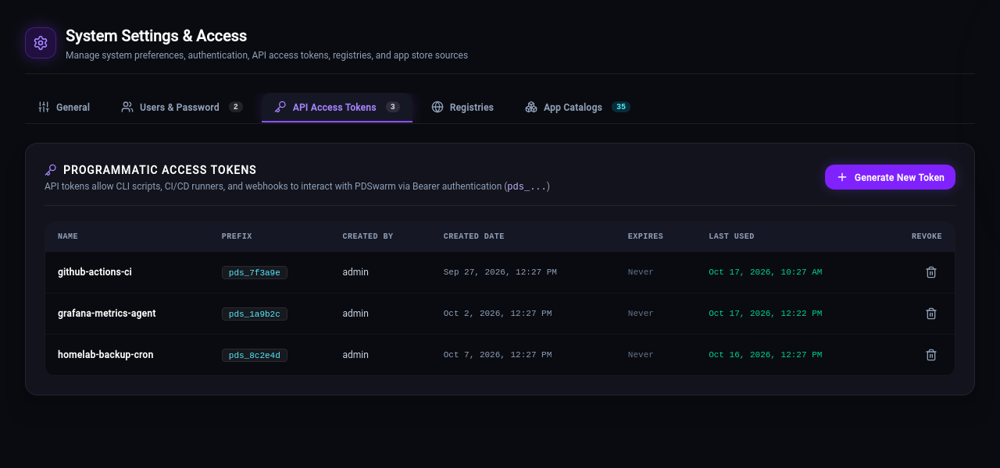

#### Private Registries

Manage authentication credentials for Docker Hub, GitHub Container Registry (GHCR), Quay, or self-hosted Harbor registries with auto-auth on pull.

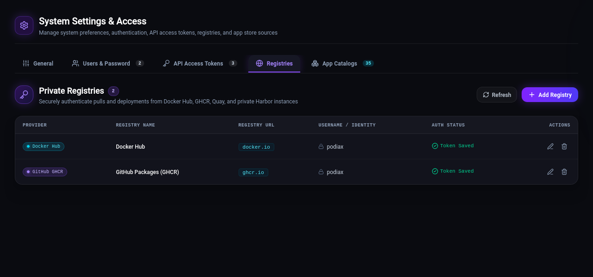

#### Template Catalogs

Manage curated application catalogs and external Portainer/CasaOS template feeds.

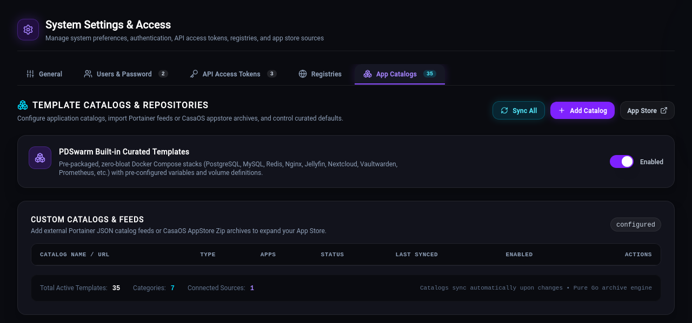
